# Strata (working title)

A native-3D evolution of the 2D sandbox-progression genre: enormous volumetric procedural worlds,
mining and building, deep underground exploration, data-driven items, huge bosses, NPC settlements,
world events and a world that transforms as you progress.

* Engine: **Godot 4.7 (.NET / C#)** · assets: **Blender 5.2** (procedural `bpy` scripts)
* Design & status: [`docs/3D_TERRARIA_MASTER_PLAN.md`](docs/3D_TERRARIA_MASTER_PLAN.md) · architecture: [`docs/architecture/`](docs/architecture)
* Rules: [`docs/CONVENTIONS.md`](docs/CONVENTIONS.md)

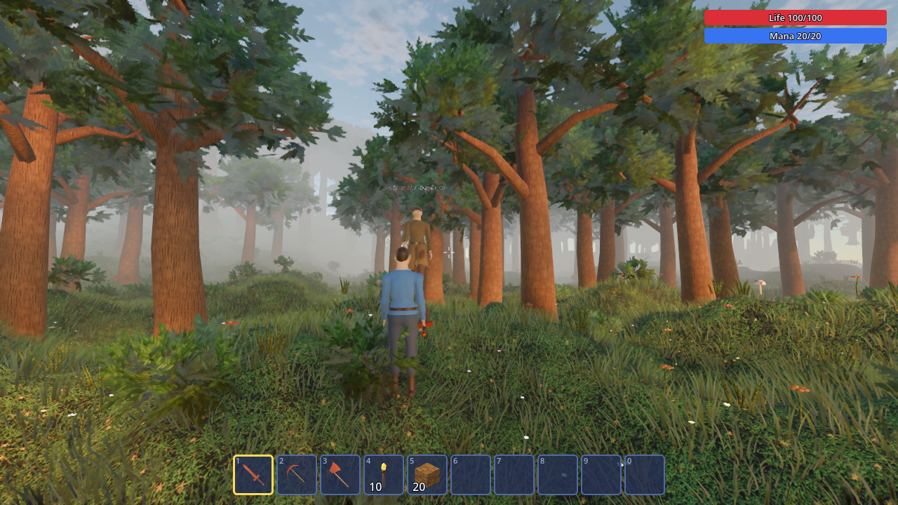

| Leaf-card trees and instanced grass by day | Night: moonlit clouds and a carried torch |
|---|---|
| 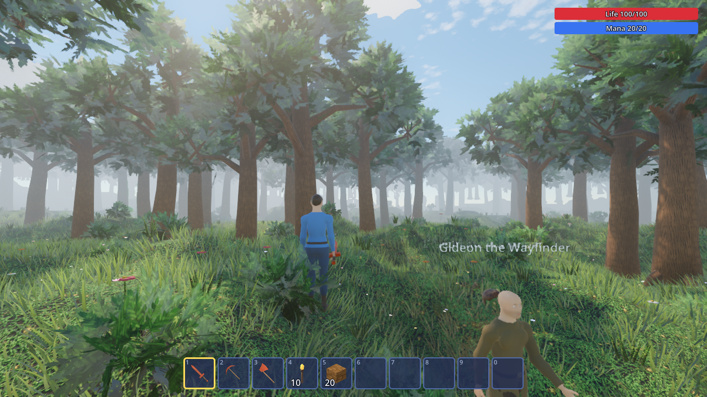 | 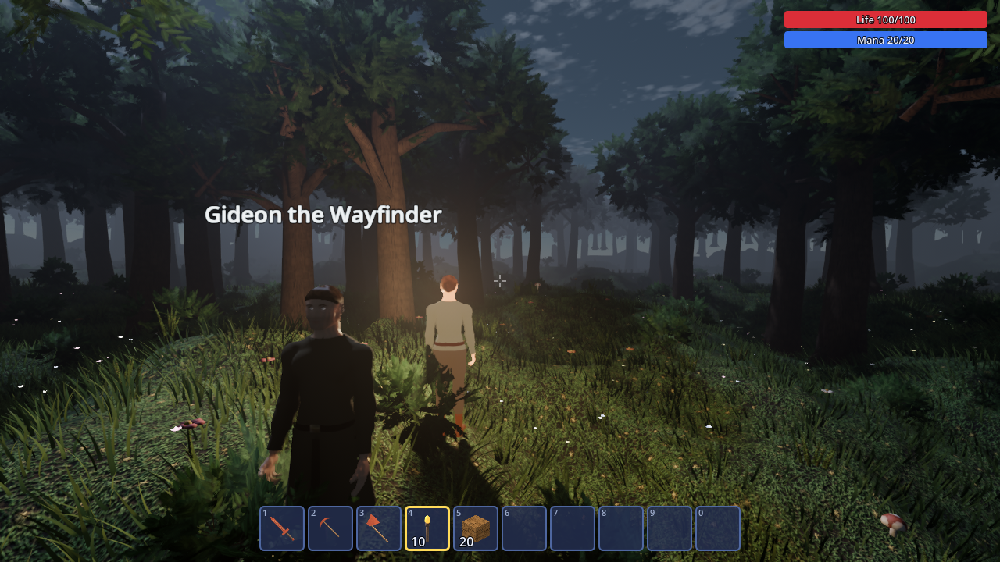 |

| Procedural townsfolk (the Nurse and the Merchant) | A bone walker up close | Lava crust over glowing cracks |
|---|---|---|
| 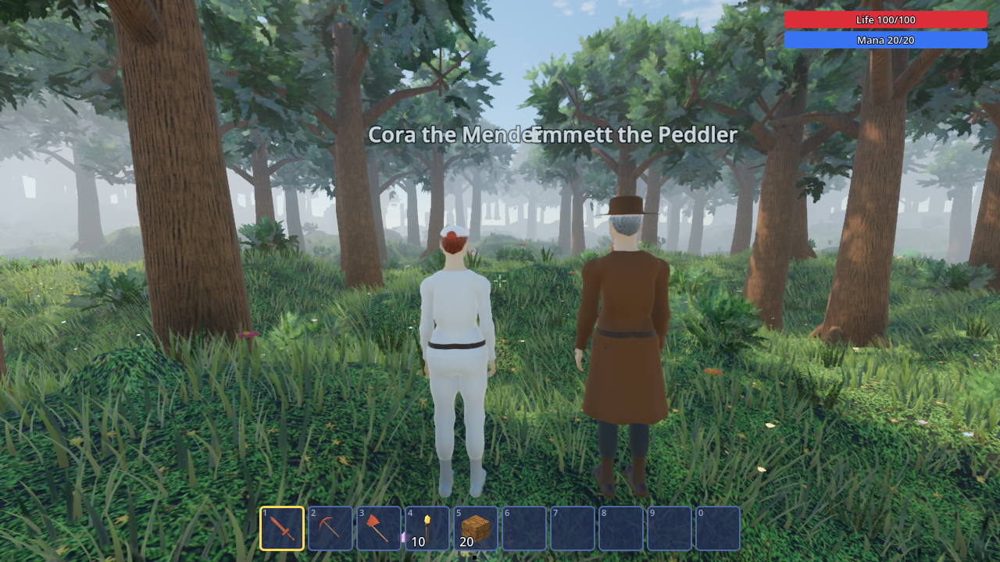 | 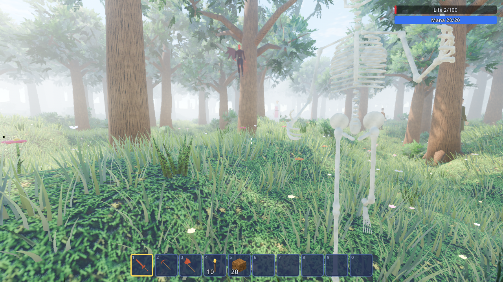 | 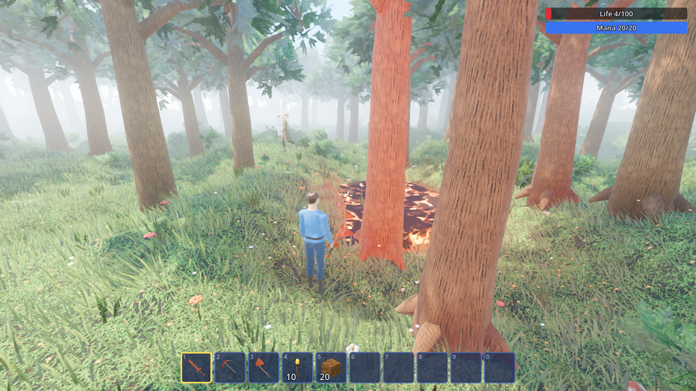 |

| The horizon: the world continues past the streamed chunks | Hardmode: a prism steed, glimmer sprites and a dread wraith in the radiant land | The Twins at nightfall |
|---|---|---|
| 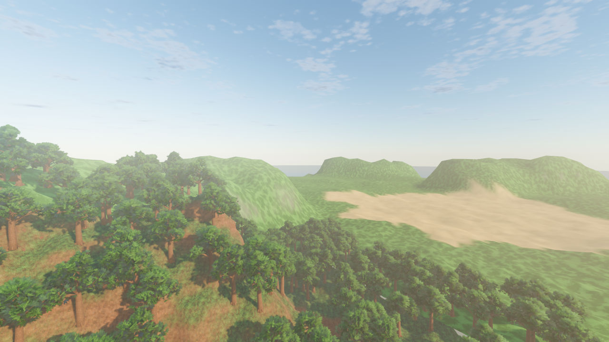 | 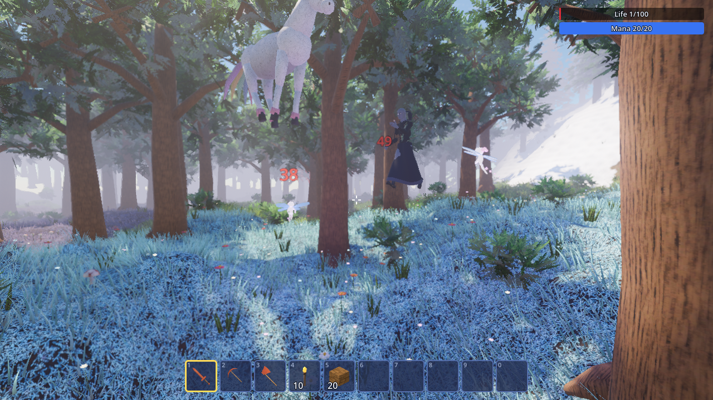 | 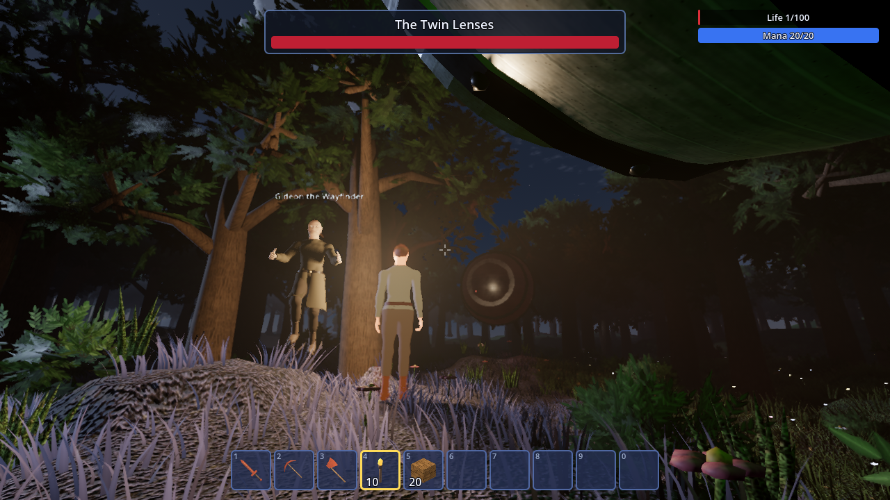 |

| Town residents | Caverns | Underworld |
|---|---|---|
| 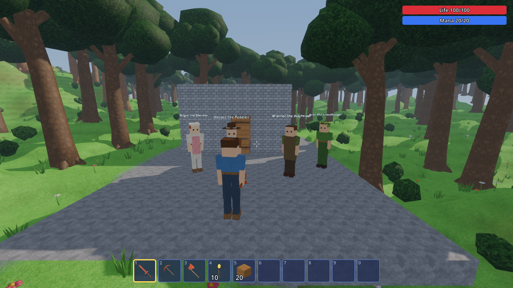 | 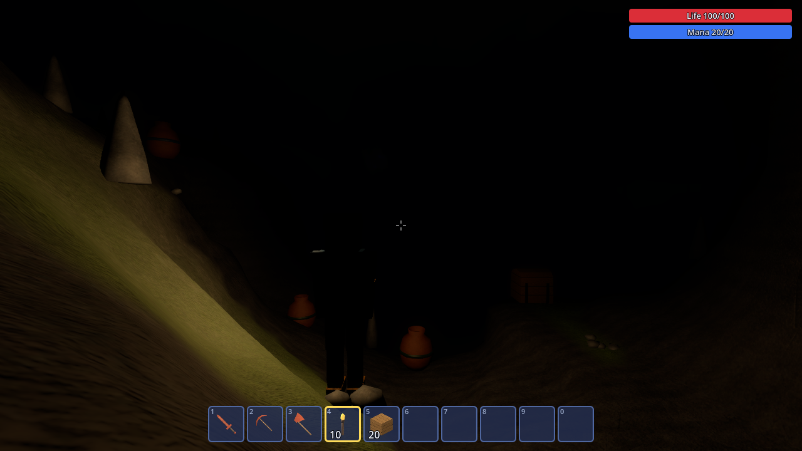 | 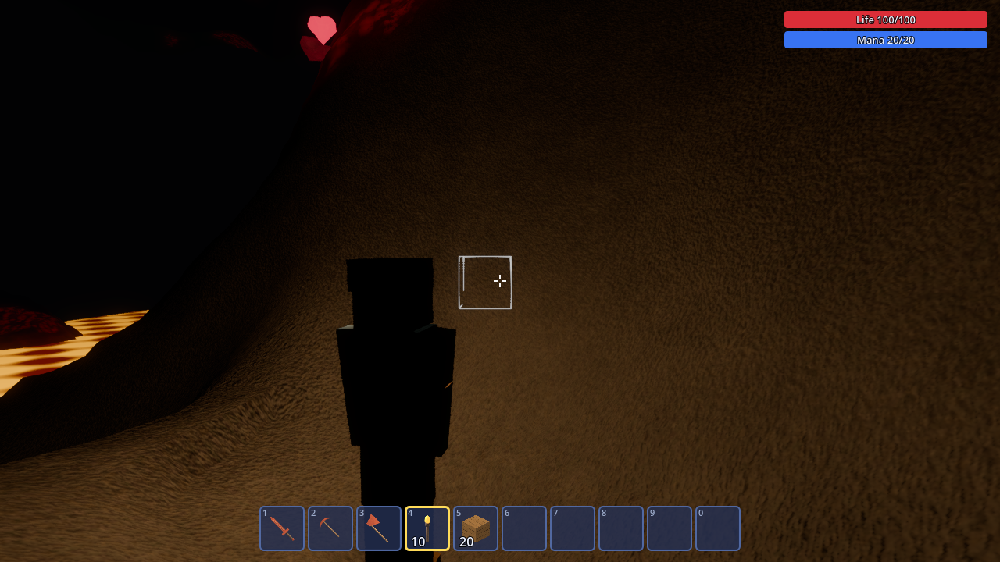 |

| The Skeletron, called out by the keeper at the Dungeon gate | The Wall of Flesh sweeping the underworld |
|---|---|
| 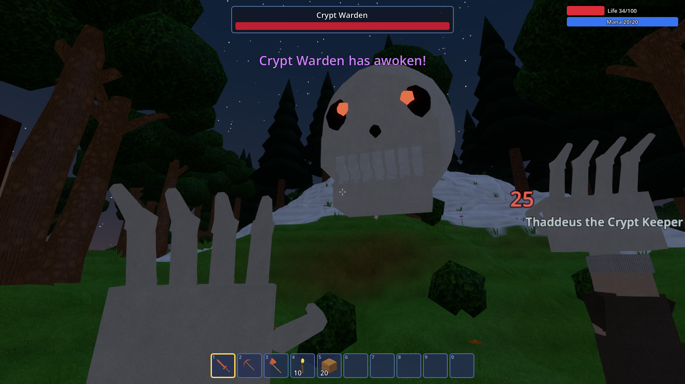 | 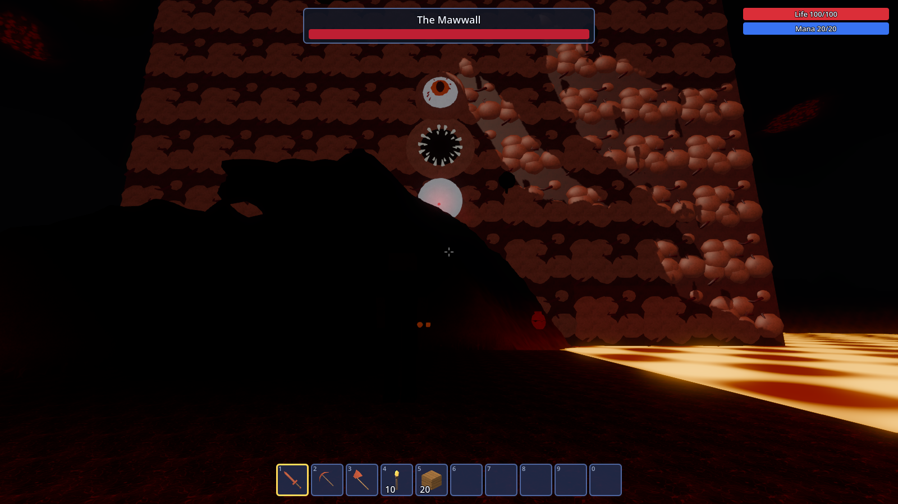 |

| Hardmode: the Hallow wedge cuts through the forest | Hardmode: the evil wedge eats the desert |
|---|---|
| 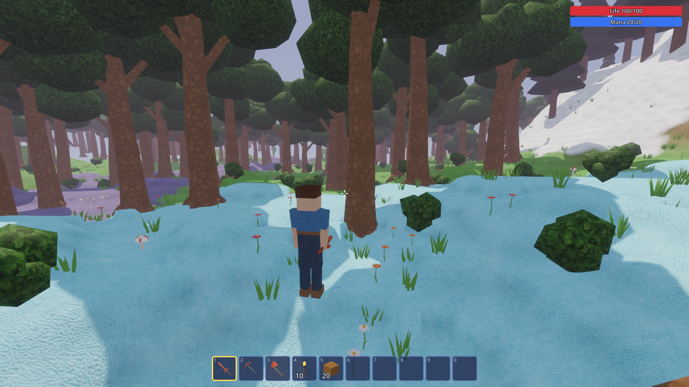 | 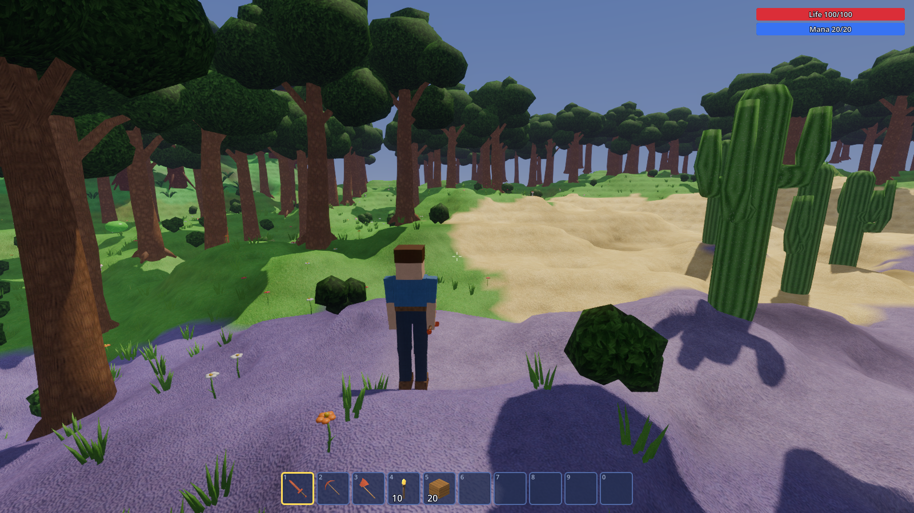 |

## Running
1. Install **Godot 4.7.x .NET** and the **.NET 8 SDK**.
2. Open `project.godot` in Godot and press Play (F5), or from a terminal: `godot --path .`. Open the project in the editor
   once after every download (or run `godot --headless --path . --import`) so new sounds, models and textures are
   imported; a terminal start does not import anything.

**No sound?** Settings → Audio → *Test sound* plays a chime made by the game itself, then a game sound, and shows the
driver, output device and how many sound files loaded (the console `audio`, `audio test`, `audio files` and
`audio device <name>` do the same). Pick another *Output device* there if the chime is silent. The startup log
(`%APPDATA%\Godot\app_userdata\Strata\logs\strata.log` on Windows) has an `audio:` line with the same details.

Command-line options (after `--`): `--world=NAME --seed=N --size=tiny|small|medium|large --new --player=NAME
--fresh-player --view=CHUNKS --hour=H --free-camera --exec="cmd;cmd" --screenshot=PATH --shots=DIR --smoke=SCRIPT
--graphics=low|medium|high|ultra`. Graphics presets live in `data/config/graphics.json` (`graphics <preset>` in the
console switches and remembers one); rendering is described in [`docs/architecture/rendering.md`](docs/architecture/rendering.md).

### Controls
| Key | Action |
|---|---|
| WASD, Space, Shift, Ctrl | move, jump (hold for height), sprint, drop through platforms |
| F, Space in the air, double-tap a direction | grappling hook (throw / let go), extra jumps, wings and rocket boots (hold), dash (with a dash accessory) |
| Mouse / wheel / 1–0 | look / hotbar |
| LMB / RMB or E | use held item (mine, chop, place, attack, throw, cast/reel a fishing rod, drink, buckets) / interact (doors, chests, beds, talk to residents) |
| T / Shift+T, R, Alt | cycle build shape, rotate, precision (single-cell) mining |
| Q (Ctrl+Q) | drop one (stack) |
| Tab or I | inventory, equipment, crafting, open chest |
| V, Ctrl+wheel | first/third person, camera distance |
| ` or F1 / F3 / Esc | console / performance overlay (FPS, GPU and CPU ms, 3D render scale) / release mouse |

Console commands include `help`, `give`, `drop`, `spawn`, `boss`, `slay`, `god`, `event`, `tp` (also `tp landmark dungeon_gate`, `tp zone hallowed`), `mutations`, `biome`, `time`, `flag`, `setblock`,
`fill`, `place`, `liquid`, `liquids`, `house`, `town`, `regen`, `inspect`, `probe`, `assert`, `save`, `stream`, `ui`, `camera`, `equip`
(`help <command>` for usage).

## Developing
```bash
dotnet build Strata.sln                                   # game layer + core + tests + tools
dotnet test tests/Strata.Core.Tests                       # core unit, determinism, gameplay, content tests
dotnet run --project tools/Strata.Tools -- validate       # content + asset validation
dotnet run --project tools/Strata.Tools -- coverage       # Terraria concept coverage (data/reference)
dotnet run --project tools/Strata.Tools -- worldgen-report --seed=1234 --size=tiny
godot --headless --path . --import                        # import assets once
godot --headless --path . -- --world=smoke --size=tiny --new --player=smoke --fresh-player \
      --view=2 --smoke=res://game/Testing/Scripts/basic.cmds   # engine smoke test (prints SMOKE PASS)
godot --path . -- --world=tour --size=small --new --player=tour --fresh-player --view=3 \
      --shots=/tmp/shots --smoke=res://game/Testing/Tours/tour.cmds   # screenshot tour (needs a GPU or lavapipe)
```

### Asset pipelines
```bash
python3 tools/textures/build_textures.py            # terrain + props texture arrays (numpy, Pillow)
python3 tools/textures/build_icons.py               # block item icons
blender --background --python tools/blender/build_all.py -- [--only=GLOB] [--no-icons]
python3.13 tools/blender/build_all.py               # same, with `pip install bpy==5.2.2`
python3 tools/blender/build_all.py --check          # coverage check only (no Blender)
python3 tools/content/gen_reference.py              # regenerate data/reference
```
On Windows: `"C:\Program Files\Blender Foundation\Blender 5.2\blender.exe" --background --python tools/blender/build_all.py`.
